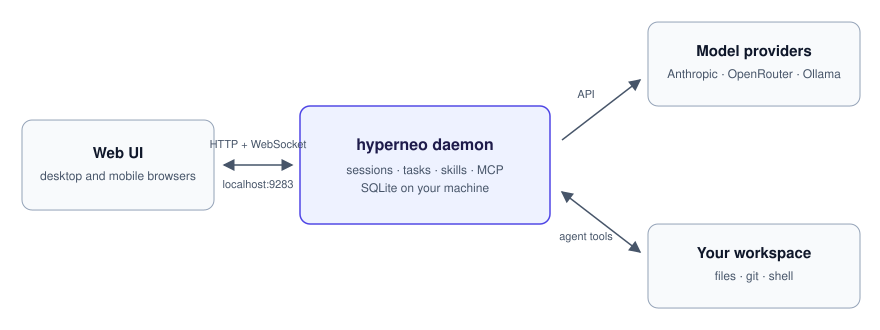

# HyperNeo

[](https://github.com/lsm/HyperNeo/actions/workflows/main.yml)

Claude Code web UI for coding, life, and anything in between.

HyperNeo runs a daemon on your machine that drives Claude Code agent sessions inside your workspace and serves a browser UI for them: several sessions side by side, model switching mid-conversation, tasks and goals with approvals, and MCP tools for files, git, and shell work. Sessions and history stay in a local SQLite database.

<p align="center">
  
</p>

## Who it's for

- Developers who use Claude Code or the Anthropic API and want a browser — including a phone — for agents working in local repositories
- Anyone running several agent sessions at once and tracking their output as tasks and goals
- People routing agents through OpenRouter or Ollama (local or cloud) instead of, or alongside, Anthropic

## Quick start

```bash
npm install -g hyperneo
export ANTHROPIC_API_KEY=sk-ant-...
hyperneo
```

Open `http://localhost:9283` and start a conversation.

Already logged in to Claude Code? HyperNeo picks up that login from `~/.claude/.credentials.json` or the macOS Keychain, so the export is optional.

Prefer a native app? [Releases](https://github.com/lsm/HyperNeo/releases) ship a desktop build: `.dmg` for macOS (Apple Silicon and Intel), `.msi`/`.exe` for Windows x64, and `.deb`/`.rpm` for Linux x64. The Linux and Windows installers are unsigned.

## CLI

```
hyperneo [options]
```

| Option | Default | Description |
|--------|---------|-------------|
| `-p, --port <port>` | `9283` | Port to listen on |
| `--host <host>` | `127.0.0.1` | Host to bind to |
| `--db-path <path>` | `~/.hyperneo/data/daemon.db` | Database file path |
| `--workspace <path>` | — | Default workspace root for file indexing |
| `-V, --version` | | Show version number |
| `-h, --help` | | Show help |

The daemon listens on loopback by default. For LAN clients such as the iOS app or another daemon, start it with `--host 0.0.0.0` (or set `HOST=0.0.0.0`) to listen on all IPv4 interfaces, or choose a specific LAN address.

Subcommands such as `hyperneo send <session-id> <text>` and `hyperneo build` interact with a running daemon; see `hyperneo --help`. A standalone daemon without the web UI is published as [`hyperneod`](https://www.npmjs.com/package/hyperneod).

## Authentication

Set one of these environment variables before starting:

| Variable | Description |
|----------|-------------|
| `ANTHROPIC_API_KEY` | Anthropic API key (recommended) |
| `CLAUDE_CODE_OAUTH_TOKEN` | OAuth token from Claude Code |
| `OPENROUTER_API_KEY` | OpenRouter API key for OpenRouter models |
| `OLLAMA_API_KEY` | Optional API key for a local Ollama server |
| `OLLAMA_BASE_URL` | Optional local Ollama URL (defaults to `http://localhost:11434`) |
| `OLLAMA_CLOUD_API_KEY` | Ollama Cloud API key |
| `OLLAMA_CLOUD_BASE_URL` | Optional Ollama Cloud URL (defaults to `https://ollama.com`) |

OpenRouter models use `provider/model` IDs such as `anthropic/claude-sonnet-4.6` and `openrouter/auto`. See [OpenRouter setup](docs/providers/openrouter-setup.md) for provider details and compatibility notes.

Ollama local and Ollama Cloud models use the native `/api/chat` and `/api/tags` APIs through HyperNeo's provider bridge. See [Ollama setup](docs/providers/ollama-setup.md) for local and cloud configuration. HyperNeo's bridging also supports GLM, Kimi, MiniMax, DeepSeek, and OpenCode endpoints.

## Features

- **Multi-session conversations** — run multiple independent agent sessions side by side
- **Spaces, tasks, and goals** — organize work, with approvals before agents act on it
- **Model switching** — swap models mid-conversation, with extended-thinking budgets from 8k to 64k tokens
- **MCP server support** — connect external tools via the Model Context Protocol
- **Skills** — plugin and MCP skills extend sessions; Fetch, Chrome DevTools, and Playwright ship built in
- **Rewind** — roll back file changes, the conversation, or both, to any earlier point
- **Runs on your machine** — npm binaries for macOS, Linux, and Windows; desktop installers; and a standalone daemon

## Development

This project uses a `dev` branch for active development. See [CONTRIBUTING.md](CONTRIBUTING.md) for details on the branching strategy and contribution guidelines.

Quick overview:
- All feature PRs should target the `dev` branch
- Releases go directly from `dev` via version tags
- Requires [Bun](https://bun.sh/) 1.3.8 or later: `bun install`, then `bun run dev` for a dev server or `bun run check` for the full quality suite

## License

[Apache-2.0](LICENSE)

The HyperNeo brand identity materials in [`docs/branding/hyperneo-visual-identity/`](docs/branding/hyperneo-visual-identity/README.md) are excluded from Apache-2.0 and are all rights reserved under their [asset license](docs/branding/hyperneo-visual-identity/ASSET-LICENSE.md). The vector export helper remains Apache-2.0.
