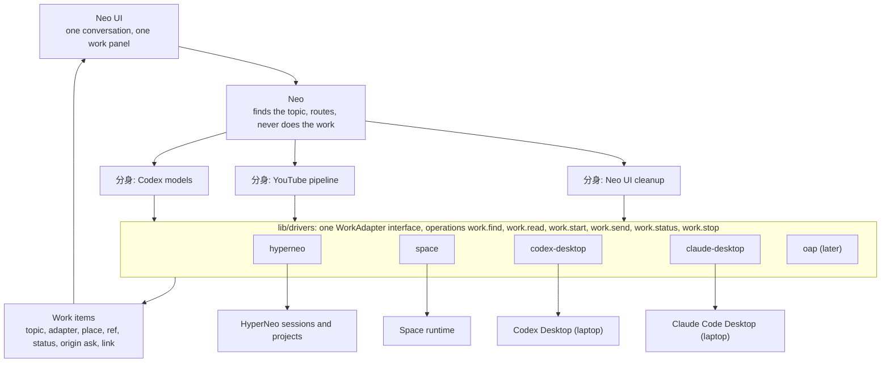
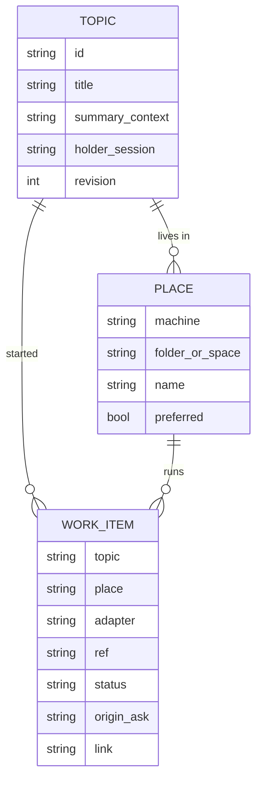
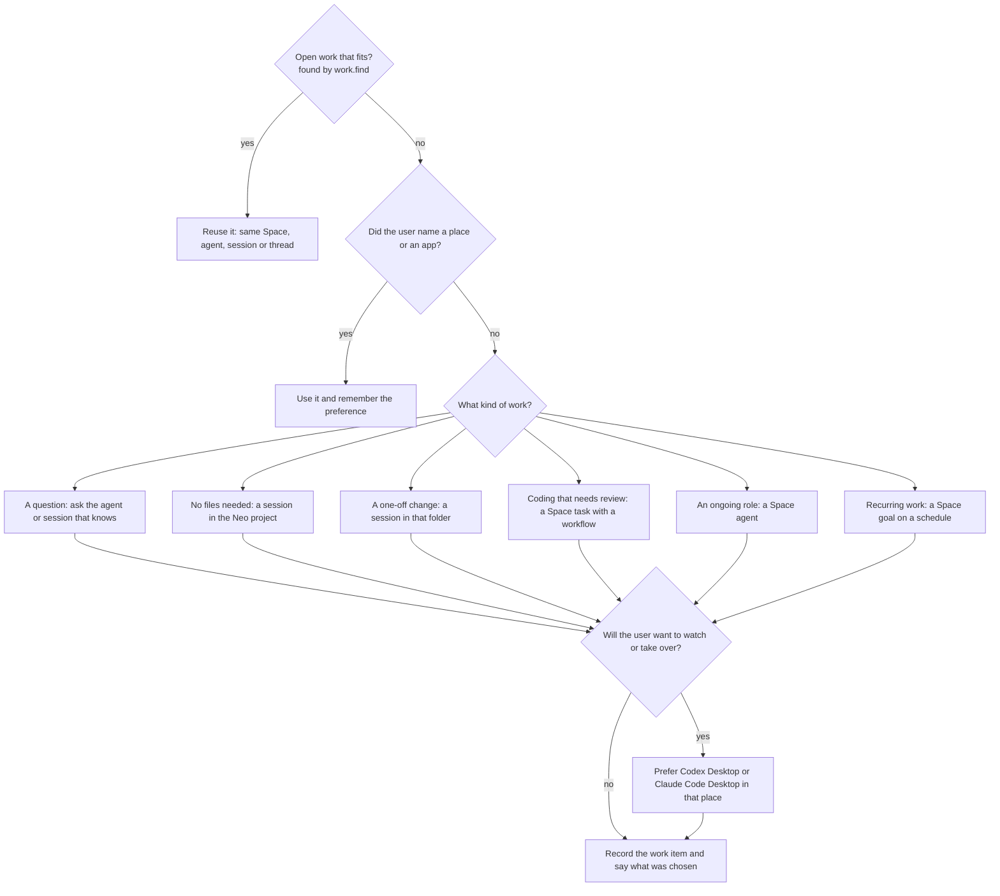
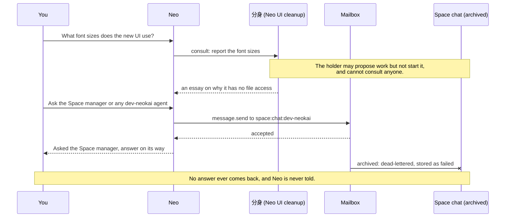
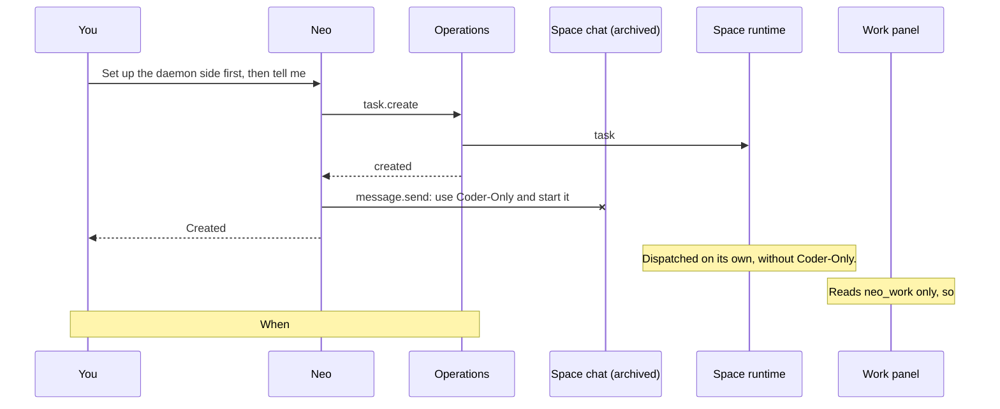
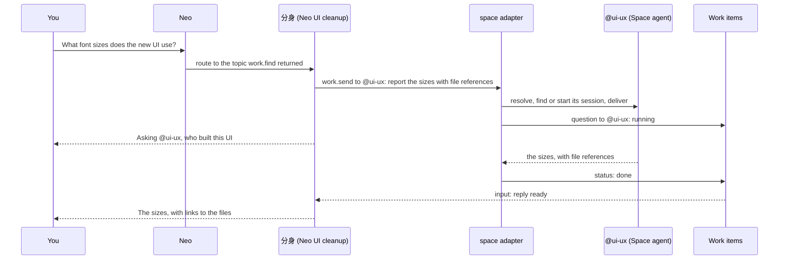
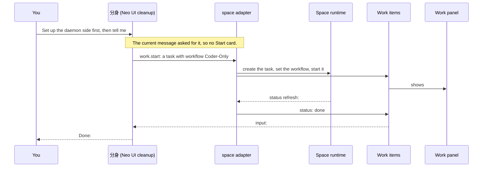
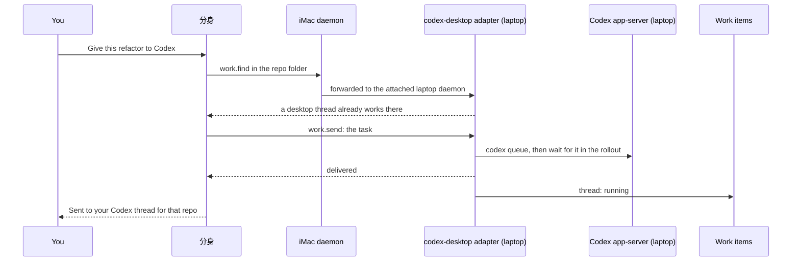
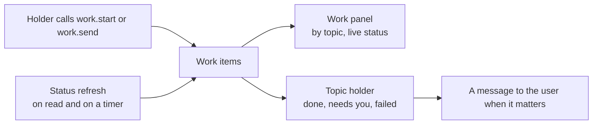
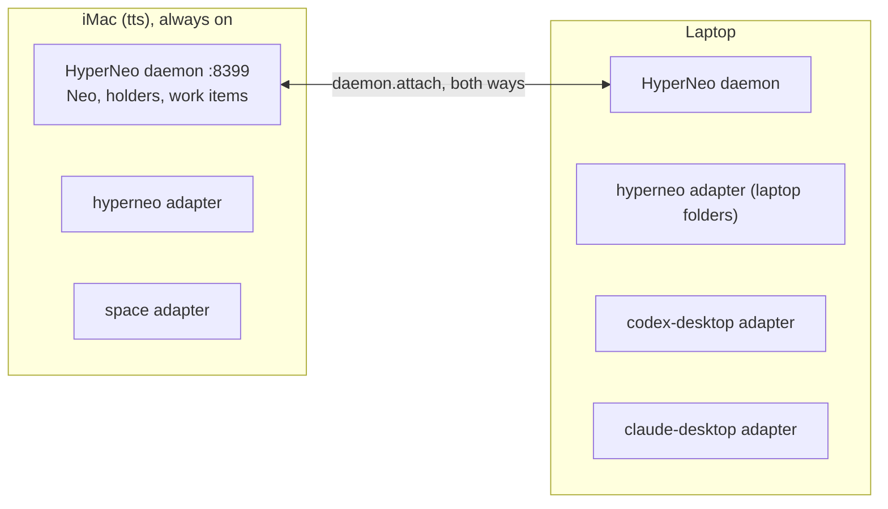

# Neo driver model

Status: agreed design, revised 2026-10-04. Follows epic #5334.

This document describes how Neo finds and drives the work that runs in other places: HyperNeo sessions and projects, HyperNeo Spaces, Codex Desktop and Claude Code Desktop. Each part traces back to a failure seen while dogfooding Neo on 2026-10-03, recorded in the tts daemon's database. The Claude Code Desktop routes were verified on the laptop with Claude Code CLI 2.1.289 and Claude Desktop 2.19675.0.

## Decisions

- **One holder per topic.** A topic can span several projects and backends. Its holder (分身) keeps the context and decides how to drive it.
- **Find open work first, and reuse before creating.** Neo searches for open work and the places it lives instead of listing everything the daemon has ever seen. When a Space, agent, session or thread already fits, the work goes there.
- **No-file sessions share one project.** Sessions that need no files go in a single named Neo project, never in temp folders named by session id.
- **Drivers are their own subsystem with swappable adapters.** `lib/drivers` defines one interface. Each backend has an adapter that implements it, so an adapter can later be replaced, for example by one built on OAP.
- **Desktop adapters stay visible.** Everything the Codex Desktop and Claude Code Desktop adapters create or change shows in that desktop app.
- **OAP is not the primary driver yet.** It is promising but young; an OAP adapter can be added behind the same interface when it matures.
- **A daemon on each Mac.** The iMac (tts) and the laptop each run HyperNeo and attach to each other both ways.

## What Neo is

Agents produce more parallel work than one person can manage session by session. Neo is the one place the user talks to. It sends each ask to a topic holder, which keeps that topic's context and decides how to move it forward: answer from what it knows, check progress, or hand work to a backend.

The backends share one shape: a place (a folder, project or Space) and units of work inside it (sessions, threads, tasks, agents). Spaces add structure for longer work: tasks with workflows, long-lived agents, goals on a schedule, and an evolve loop. Neo uses Spaces where they fit and keeps them out of the user's way otherwise.

The UI stays simple: one conversation and one work panel, with a way into any session when the user wants detail.

## The model



What each layer never does:

- Neo never does a topic's reasoning or work, and never lists everything. It finds open work, routes, and answers small talk.
- A holder never says "I can't". When it lacks an answer, it asks an agent or session that has one, through an adapter.
- An adapter never decides what to do. It operates one backend and reports what happened.
- The work panel never reads a backend directly. It reads work items, so a new adapter shows up without UI changes.

## The adapter interface

The sketch below shows the core operations. The current contract in `packages/daemon/src/lib/drivers/types.ts` also has optional capabilities such as `steer`, `queue`, `withdraw` and `archive`; each adapter declares its actual supported set.

```ts
type WorkStatus = 'queued' | 'running' | 'needs_you' | 'done' | 'failed' | 'stopped';
type Place = { machine: string; folder?: string; spaceId?: string; name: string };
type WorkRef = { adapter: string; daemon?: string; id: string };

interface WorkSummary {
  ref: WorkRef;
  title: string;
  place: Place;
  status: WorkStatus;
  lastActivityAt: number;
  link?: string;
}

interface PlaceGroup {
  place: Place;
  lastActivityAt: number;
  openCount: number;
  archivedCount: number;
  adapters: string[];
  work: WorkSummary[];
}

type WorkRejection =
  | 'unknown_adapter'
  | 'unsupported'
  | 'not_found'
  | 'not_open'
  | 'not_delivered'
  | 'unreachable'
  | 'invalid_place';

type Result<T> = { ok: true; value: T } | { ok: false; reason: WorkRejection; detail: string };

interface WorkAdapter {
  id: string;
  capabilities: ReadonlyArray<'find' | 'start' | 'send' | 'status' | 'stop'>;
  find(q: { text?: string; place?: Place; includeClosed?: boolean; limit: number }): Promise<PlaceGroup[]>;
  start(w: { place: Place; title: string; message: string }): Promise<Result<WorkSummary>>;
  send(ref: WorkRef, message: string): Promise<Result<{ delivered: boolean }>>;
  status(ref: WorkRef): Promise<Result<WorkSummary & { lastReply?: string }>>;
  stop(ref: WorkRef): Promise<Result<void>>;
}
```

- Five core verbs in this sketch. Finding a place is part of `find`, a deep link is a field, and push events wait: status is refreshed on read and on a timer until a backend can push.
- Rejections are result values with a named reason, following ADR 0006; `detail` carries the backend's own words. `unknown_adapter` and `unsupported` come from the operation layer (an adapter id that isn't registered, or a verb it doesn't declare). `not_found` and `not_open` cover a ref that doesn't exist or is archived or ended, such as `message.send`'s archived and ended rejections. `not_delivered` means the backend refused or dropped the message. `unreachable` means the other daemon didn't answer. `invalid_place` is a folder or Space the adapter can't start work in.
- `capabilities` makes a missing verb explicit. The `claude-desktop` adapter declares `find`, `start`, `send`, `steer`, `status` and `archive`; its send/steer owner gate may refuse a particular session. It declares no `stop`, `queue` or `withdraw`, so Neo reports unsupported control and offers Open session.
- A different implementation of the same backend can replace an adapter in the registry without touching Neo.

## Operations

Neo reaches every adapter through one set of operations:

| Operation | What it does |
| --- | --- |
| `work.find {text?, folder?, spaceId?, adapters?, includeClosed?, limit?, localOnly?}` | Asks every local adapter and, unless `localOnly` is set, every attached daemon; merges the results by place and returns the groups most recent first, with a calling Neo project's own folders ahead of the rest (except for an `id` lookup), plus any source that could not answer. |
| `work.start {adapter, place, title, message}` | Starts new work in a place and records a work item. |
| `work.send {ref, message}` | Sends to existing work, confirms delivery, and records a work item. |
| `work.status {ref}` | Returns the current status, the last reply and the link. |
| `work.stop {ref}` | Stops the current turn, when the adapter supports it. |

- A reference with a `daemon` is forwarded with `remoteDaemons.invoke(daemon, 'work.…', input)`, which already exists and calls any operation on an attached daemon. `work.find` sets `localOnly: true` when it fans out, so two daemons attached both ways never ask each other in a loop.
- `work.start` and `work.send` run straight away when the user's current message asked for the work. When a holder decides on its own, Neo shows a Start card first.

## Finding work and places

Today Neo calls `daemon.snapshot` at the start of every turn. For each kind of record it returns a total and the 20 most recently active items. Archived items are hidden, but ended sessions and done or cancelled tasks are still listed. On 2026-10-03 Neo saw a total of 2,451 sessions and the names of twenty.

`work.find` replaces that, and it also serves as the project list, so no separate operation is needed:

- With no text it returns every place, most recent first, with its open work.
- With text it matches place names, work titles and content. HyperNeo already keeps a full-text index over messages and tasks (`message_search_content` / `message_search_fts`), so far used only by the UI's `message.search` RPC.
- A place appears even when nothing in it is open, so Neo can start new work there and resolve "in dolmen" to a folder.
- Groups merge across adapters on the same machine: `~/focus/dolmen` is one place whether its work lives in Claude Code Desktop, Codex Desktop or HyperNeo. Neo then picks an adapter inside the place by the rules under "How Neo chooses".

| Kind | Counts as open | Left out by default |
| --- | --- | --- |
| HyperNeo session | active, paused, pending worktree choice (shown as needs you) | ended, archived |
| Space task | draft, open, in progress, review, approved, blocked, rate or usage limited | done, cancelled, stopped, archived |
| Space agent | active, paused | disabled, archived |
| Space | active, including paused | archived, stopped |
| Codex thread | in the thread list | archived, guardian review sub-threads |
| Claude Code Desktop session | not archived | archived |
| Work item | queued, running, needs you | done, failed and stopped, once the user has been told |

Where each adapter gets its places:

| Adapter | Places |
| --- | --- |
| hyperneo | session folders, workspace history, the Neo project |
| space | Spaces and their registered workspaces |
| codex-desktop | thread working directories in `~/.codex/state_5.sqlite` |
| claude-desktop | each session's origin folder in the app's session records, archived sessions included |

## Topics, places and work items



- **Topic** exists today as `neo_concerns`.
- **Place** links a topic to where its work lives, for example "this topic's code is in the dev-neokai Space" or "this topic uses the Codex thread in that repo". A topic can have several.
- **Work item** grows out of `neo_work`. `neo_work_resources` and `neo_agent_work_targets` fold into it.

Topics, places and work items belong to Neo. `lib/drivers` owns how each backend is operated.

## Adapters

### hyperneo

HyperNeo's own sessions and projects. They run on the Claude Agent SDK and show in HyperNeo, not in the Claude Code Desktop app.

- `find`: open sessions plus the full-text index, grouped by session folder.
- `start`: a session in the folder's project, or in the Neo project when no files are needed.
- `send`: the `message.send` path, which rejects archived and ended targets (#5580) and reports delivery (#5582, #5584).
- `status`: processing state and the last reply. `stop`: await public SDK interruption and verify the owned runtime stopped; never restore a session merely to stop it.
- `queue`: defer through the existing mailbox until the active turn ends; return the mailbox entry ID. `withdraw`: remove only the caller/target-matched deferred input before SDK dispatch or consumption. Atomic claims and tombstones keep retries idempotent; active or consumed inputs are not retractable. These are direct driver methods, not a new Neo usage policy.

### space

HyperNeo Spaces. The adapter calls the Space task operations as the real caller, so an agent keeps its own Space's gates; Neo, which acts for the user everywhere, runs them with internal authority.

- `find`: Spaces, their open tasks and agents.
- `start`: a task with a workflow, or a message to an agent by `@handle` (#5586).
- `send`: `task.message.send`, or `message.send` to an agent.
- `status`: the task's status. `stop`: cancel the task.

### codex-desktop

Runs on the laptop, ported from the `codex-driver` skill. Everything it does shows in Codex Desktop.

- `find` and `status`: `~/.codex/state_5.sqlite` and the thread's rollout file.
- `start`: a short-lived stdio app-server creates and names the thread using the desktop's bundled CLI when available. Neo closes stdin and waits for the process to exit and flush its saved thread, opens its `codex://threads/<id>` link, and discovers the desktop owner over `~/.codex/ipc/ipc.sock`. The opening turn is sent directly to that owner, with the confirmed model and effort. The shared background daemon must not own newly created desktop threads; visibility in the sidebar alone does not make a thread editable in the desktop. The desktop must be running and its local IPC protocol must support the handoff; failures leave the saved thread without submitting its opening message elsewhere.
- `send` and `queue`: native `thread/queue/add` with experimental API capability, returning the queued submission ID. The rollout confirms delivered input and its receipt. A server connection failure before submission or an unsupported queue method uses `codex queue --thread <id> --message …`, preserving its printed queue ID; failures after a possible submission never retry through the CLI.
- `steer`: read `thread/turns/list` and send `turn/steer` with the active turn’s exact ID. An idle thread or a changed turn is reported without queueing.
- `withdraw`: list the thread queue and delete the named queued submission. Already delivered, steered or removed messages return a `not_queued` fact. These three capabilities are direct driver methods; RPC/MCP work-operation routes are a separate change.
- `stop`: interrupt the turn through the app-server. `link`: to be found.

### claude-desktop

Uses Claude Desktop's local session records for discovery and its standard deep link for opening the app. The session's owner selects the channel; a running Claude.app does not make every CLI session Desktop-owned. The inspected Desktop version exposes no outside-daemon management socket/API. Its renderer IPC and in-process MCP tools are not daemon interfaces.

| Verb | How |
| --- | --- |
| `start` | Run a short, tool-less CLI preparation turn in the configured initial mode, preserving the configured worker model. Wait for it to exit and for `claude --desktop --resume` to register the native session. B1 option B accepts Desktop's actual imported `acceptEdits`; it does not claim to preserve bypass Neo's mode. The Haiku `desktop-wake` helper then invokes native `send_message` with the exact task. Only the target's complete native input and receipt count as task delivery. |
| `send`, `steer` | Use the same native forwarding helper, including for idle sessions. The one-shot sender explicitly uses the helper's actual mode, without changing global settings. A helper's response or a queued request does not prove target delivery. Failed native delivery never starts a headless task. Concurrent wakes share helper preparation/import. A live forwarding helper is reused; stopped helper histories are retained while a fresh unprivileged Haiku helper is prepared. |
| `find`, `status` | `claude agents --json` supplies live status, PID and session identity; join the exact registration to classify the owner. App records supply title, folder, archive state and activity; transcripts supply replies and exact input-receipt evidence. Observation does not grant control. |
| `archive` | Existing record-based archive path: require exactly one matching app record, recheck its identity and live status, then call the archive admission gate. Atomically replace the record with `isArchived: true`, preserving its other fields; this does not stop a turn. |
| `link` | `claude://claude.ai/epitaxy/local_<uuid>`. |
| `stop`, `queue`, `withdraw` | No verified outside-daemon Desktop management interface. These capabilities are not declared for external sessions; open the app to act there. |

Constraints:

- `claude --desktop` is only a UI launcher and requires a terminal, so use `script -q /dev/null claude --desktop --resume <uuid>`. Do not spoof a renderer, inject JavaScript, bypass origin checks or rewrite app records to claim ownership, change permissions or manufacture delivery/control evidence. The existing admitted `archive` record update above is a separate, version-sensitive mechanism; it is not an outside-daemon Desktop management API.
- CLI/SDK ownership requires the inspected CLI 2.1.295 or app-bundled CLI 2.1.299; a matching Desktop registration remains Desktop-owned even on a newer version. Direct inbox delivery accepts only the verified 2.1.295 protocol and revalidates the live PID/session registration and its registered path. A version or owner mismatch is a refusal, not permission to restore a session.
- The inbox NDJSON framing is undocumented and may change. `next` wakes idle CLI sessions or delivers at the next tool round; it does not interrupt a tool. No reliable external turn-end queue, withdrawal or stop command was verified, so no such socket control is invented.
- A completed socket write returns `delivered:false, unconfirmed:true` with its exact input receipt. Immediate peer acceptance need not produce an ACK. Neither a write nor a peer transport receipt proves work completion or human approval.
- The daemon owns the reply listener until shutdown and persists replies to the originating local daemon session with peer provenance. Anonymous/chat/remote reply destinations are unsupported; listener lifetime is not durable across a daemon restart. Same-UID socket/path checks are not peer authentication.
- Cancelling a human request does not prove execution stopped. A failed control remains visible as `controlFailure: { operation, reason, detail, at }` with unsupported/unavailable detail and Open session; there is no invented retry button.

### claude-code

Standalone CLI sessions share the same owner gate and inbox sender as confirmed CLI sessions discovered through Desktop records. The adapter offers `find`, owner-verified `status`, `send` and `steer`; it has no creation, stop, turn-end queue or withdrawal capability. Status and delivery evidence reuse the native transcript and exact input UUID. Daemon-owned SDK sessions remain on `hyperneo`, whose cached runtime and deferred mailbox support the controls described above.

### Creation permission defaults

New work started through HyperNeo requests Full Access through the supported permission parameters:

- Codex: `thread/start` sends `approvalPolicy: "never"` and `sandbox: "danger-full-access"`. The opening turn request carries the public `turn/start` fields `approvalPolicy: "never"` and `sandboxPolicy: {type: "dangerFullAccess"}` so desktop handoff does not lose the requested permissions. The pre-existing undocumented desktop ownership/IPC handoff is unchanged; no private permission setter, session database edit or global configuration change is introduced. A server policy rejection is returned without a weaker-permission retry.
- Claude Code CLI: the short creating turn passes `--permission-mode` from `neo.workerPermissionMode`, disables tools/MCP for preparation and waits for exit. The actual task arrives later through Desktop's native messaging tool; the creating turn never receives it.
- Claude Code Desktop: the human chose B1 option B (message `4aa1e100-4e51-4d38-b9cd-5e44268a7343`): accept `acceptEdits` after handoff. CLI2.1.302 rejects a permission flag with `--desktop`; Desktop3.6556.1 explicitly downgrades imported bypass to acceptEdits. Report actual `permissionMode`, `needs_you` and native `waitingFor`; do not approve prompts, rewrite native records or change global `defaultMode`. The existing authorized `rc-toggle` handles RC; no replacement RC helper is created. A queued RC request is not a connected session or phone-view confirmation. The standalone `claude-code` adapter still has no creation API.

Interface evidence (2026-10-16): both `codex-cli 0.160.1` and the desktop-bundled `codex-cli 0.162.0-alpha.17.2` public `codex app-server generate-json-schema` outputs include both permission fields and the above sandbox enum values; `claude 2.1.295 --help` exposes `--permission-mode`. See the official [Codex App Server protocol](https://learn.chatgpt.com/docs/app-server), [Codex Full Access definition](https://learn.chatgpt.com/docs/sandboxing), [Claude CLI reference](https://code.claude.com/docs/en/cli-reference), and [Desktop permission settings](https://code.claude.com/docs/en/desktop#choose-a-permission-mode). Unit tests exercise the real adapter creation functions with recorded transport/process arguments; they do not establish that a live Desktop application accepted or displayed the requested mode.

Work-location interface evidence (2026-10-27): generated public schemas from
standalone codex-cli 0.160.1 and Desktop-bundled 0.164.0-alpha.11.1 both declare
thread/start developerInstructions as string/null. The repeatable
codex-work-locations-schema verification journey checks the installed binaries
with an isolated HOME/CODEX_HOME. This establishes the request-field contract;
native model delivery and Desktop rendering remain separate proof surfaces.

### Status mapping

| Status | hyperneo | space | codex-desktop | claude-desktop |
| --- | --- | --- | --- | --- |
| queued | message accepted, not yet picked up | draft, open, rate or usage limited | message queued | unconfirmed write, awaiting exact input evidence |
| running | processing | in progress | turn active | `busy` |
| needs you | waiting for input or a worktree choice | review, blocked | approval requested | `waiting` (permission prompt or input needed) |
| done | idle after the reply | done | turn completed | `idle` after the reply |
| failed | turn or delivery error | (none) | turn error | turn error in the transcript |
| stopped | interrupted | cancelled, stopped | interrupted | (no stop) |

## OAP

The Open Agent Protocol (`~/focus/open-agent-protocol`) defines one boundary between a control layer and an agent loop: sessions, runs, streamed events, cancellation, recovery, and permission and question prompts. `oapx` serves Claude Code, Codex app-server, Pi, ACP agents, Hermes, DeepSeek and OpenCode behind it. Findings from the session that works on that repository:

| Question | Answer |
| --- | --- |
| Surface to embed | `oapx hub --stdio --config` is the most stable. Live streaming needs the `oapx hub --addr` HTTP+SSE wire with `clients/ts`. |
| Attaching to open desktop threads | Not supported. Reopen resumes only sessions the hub recorded. |
| Listing a harness's history | Out of scope. |
| Restarts | A hub restart is a cold reconnect: live sessions, pending prompts and replay are lost. |
| Desktop app visibility | Untested. |

Its run events map one-to-one onto the six statuses (`run.started` running, `action.permission.requested` and `user.input.requested` needs you, `run.completed` done, `run.failed` failed, `run.cancelled` stopped). When it matures, an `oap` adapter can implement `WorkAdapter` over `oapx hub`, first for harnesses with no native adapter (Pi, OpenCode, ACP agents), and possibly behind codex-desktop or claude-desktop once desktop visibility is proven.

Using OAP as the model backend for the daemon's own sessions is a separate question from this adapter; see [the OAP backend plan](oap-backend-plan.md).

## How Neo chooses



Preferences the user states, such as "dolmen work goes to its Codex thread", are saved in the topic's context and answer the second question next time.

## Walkthroughs

### Today: the font-size question



### Today: task #2008



### With adapters: the font-size question



### With adapters: task #2008



### With adapters: opening Claude Desktop from a local daemon session

```mermaid
sequenceDiagram
  participant H as Local daemon session
  participant A as claude-desktop adapter (laptop)
  participant CLI as claude CLI (laptop)
  participant App as Claude Code Desktop
  H->>A: work.start in ~/focus/dolmen, local reply destination
  A->>A: validate reply destination before creation
  A->>CLI: tool-less preparation turn, then exit
  A->>CLI: claude --desktop --resume U, under a pseudo-terminal
  CLI->>App: open local_U in the sidebar
  A->>App: confirm native registration and actual permission mode
  alt Import failed or native helper unavailable
    A-->>H: task not confirmed; inspect native wait or refusal
    Note over A,App: No headless task fallback or permission approval
  else Registered Desktop session
    A->>App: desktop-wake Haiku helper calls native send_message
    App-->>A: target user-input receipt
    A-->>H: receipt, actual acceptEdits mode and pending permission wait
    A->>App: existing authorized rc-toggle requests Remote Control
    Note over A,App: Request alone does not prove RC connected or phone visibility
  end
```

### With adapters: a hand-off to Codex Desktop



## Status and follow-up



`work.start` and `work.send` record the work item themselves, so recording does not depend on the model remembering to file a card. Until backends can push, the drivers subsystem refreshes the status of open work items when they are read and on a timer. When an item reaches done, needs you or failed, its holder gets an input and Neo tells the user through the existing nudge and publication machinery. Every work item has a way in: HyperNeo sessions and Space tasks open in place (the session pane from #5525); desktop items open their app through the link.

## Where adapters run



- An adapter runs next to its backend. Desktop adapters run on the laptop, where the apps are.
- `remoteDaemons.invoke` already forwards any operation to an attached daemon. Attachments live only in memory today, so M6 stores them in global settings and restores them at startup.
- The daemons' RPC door has no caller identity: any WebSocket peer that reaches it calls operations as the local user, including `daemon.attach`. That exposure exists whether or not attachments are remembered, so both daemons stay on the private network (Tailscale) for now, and a shared-secret handshake on attach and on the RPC door is planned as its own security slice.

## Gaps and fixes

| Gap | What happened | Fix | Status |
| --- | --- | --- | --- |
| G1 Holders can't act | The holder answered a font-size question with an essay about having no file access; its prompt forbids starting work or consulting others. | Holders route and delegate through `work.*`. | M4 |
| G2 Sends to dead sessions looked successful | Every message to the archived dev-neokai Space chat since 9/21 was stored as failed while Neo reported success. | Reject archived and ended targets, notify the sender, expose delivery status, address agents by name. | Merged: #5580, #5582, #5584, #5586 |
| G3 Neo can't find open work | `daemon.snapshot` showed 2,451 sessions and the 20 most recent, mixed with ended sessions and done tasks. HyperNeo work landed outside the dev-neokai Space. | `work.find`: open work grouped by place, places included. | M1, M4 |
| G4 Projects named by session id | Scratch work runs in `/var/folders/…/hyperneo-neo-work/<session id>`, and the sidebar names projects after folders. | One named Neo project for no-file sessions. | M2 |
| G5 Work Neo starts is invisible | #2007–#2009 were made with `task.create`; the panel reads `neo_work`, last written 9/29. | `work.start` and `work.send` record work items; the panel reads them. | M5 |
| G6 Nobody follows up | Nothing reports when #2008 finishes; a card has been queued since 9/29. | Status refresh and holder notifications. | M9 |
| G7 Space gates block Neo | Cancelling #2007 was denied; `workflow.list` returned `space_not_resolved`; session reads were protected. | Session reads fixed; the space adapter calls Space managers directly. | #5535 merged; M3 |
| G8 All backend knowledge in one prompt | The root prompt is about 18k characters. | Root Neo learns `work.*`; adapter specifics live in the drivers subsystem. | M4 |
| G9 The approval path never runs | Neo skips work cards and calls `task.create` directly. | Approval at `work.start` and `work.send`. | M4, M5 |

## Plan

The minimal path. Each slice stays under the 300 production-line limit from ADR 0004, with construction, wiring and deletion in separate PRs.

| Slice | What | Closes | Needs |
| --- | --- | --- | --- |
| M1 | `lib/drivers` core: the `WorkAdapter` interface, the registry, the five `work.*` operations with routing to attached daemons, and the hyperneo adapter's `find` and `status`. | G3 | none |
| M2 | hyperneo `start`, `send` and `stop`, and the named Neo project for no-file sessions. | G4 | M1 |
| M3 | The space adapter. | G7 | M1 |
| M4 | Neo wiring: `work.find` instead of `daemon.snapshot`, holders use `work.*`, approval for holder-initiated work. | G1, G3, G8, G9 | M2, M3 |
| M5 | Work items recorded by `work.start` and `work.send`; the panel lists them with status. | G5, G9 | M4 |
| M6 | Store and restore daemon attachments; run the laptop daemon attached both ways. | (enables M7, M8) | M1 |
| M7 | The codex-desktop adapter. | new backend | M6 |
| M8 | The claude-desktop adapter: `find`, `status`, `start`, `send` and `link`. | new backend | M6 |
| M9 | Status refresh on a timer, holder inputs and messages on done, needs you and failed. | G6 | M5 |

After M5, Neo drives HyperNeo and Spaces correctly on the iMac. M7 and M8 add the desktop apps.

Later, outside the minimal path: a shared-secret handshake for daemon attach and the RPC door, push events instead of refresh, an `oap` adapter, `stop` for Claude Code Desktop when the app offers a way, a Codex Desktop deep link, and editing a topic's places in the UI.

## Open questions

1. Adopt the six statuses everywhere, including OAP later? This document assumes yes.
2. Which status changes reach the user as a message? The proposal: done, needs you and failed.
3. Should `work.find` search desktop transcripts, or only titles and folders, to start with?
4. Should a topic's places show in the UI where the user can edit them, or only change through conversation?
