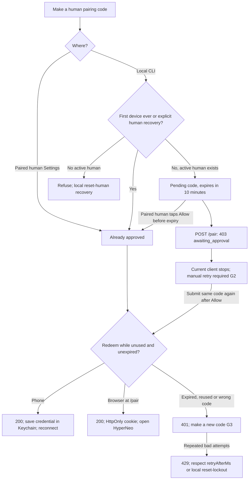
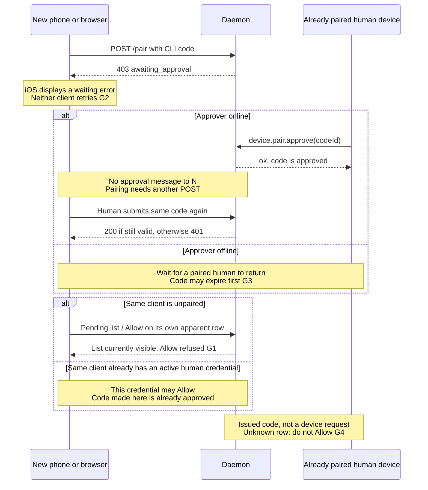
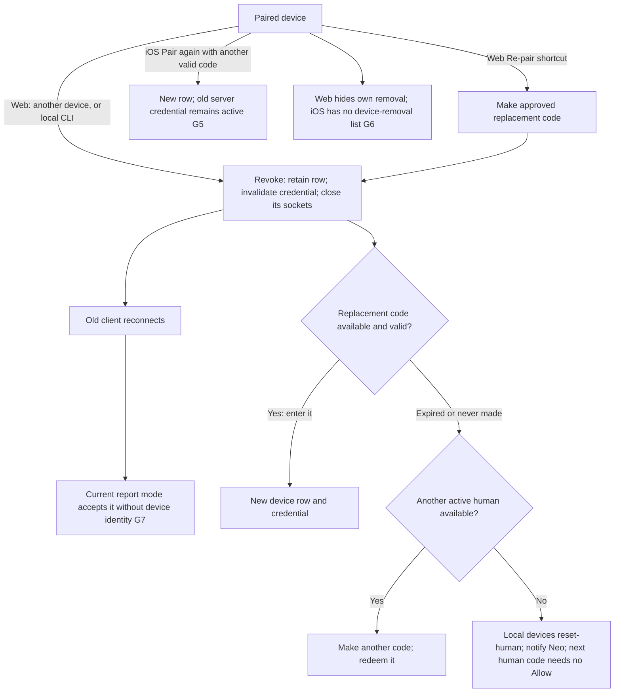

# Device pairing: current flow and smallest fixes

Stage 1, docs only. Read at HyperNeo `65b2b60ab4` and neo-ios
`2b62ba52a0` (read only), against the human's 2026-10-22 screenshot.
**A pending row is an issued code, not a connected device or proof of identity.**
Allow authorizes that code; it does not pair the requesting phone itself.

## Issue and redeem: new phone or browser

The first-device check counts revoked history too: ordinary removal never reopens
bootstrap. Codes made by an already paired human need no second Allow. Native
pairing returns a credential; a browser Origin receives only an HttpOnly cookie.
Sources: `packages/daemon/src/lib/pairing/pairing-operations.ts:32`,
`packages/daemon/src/storage/repositories/device-pairing-repository.ts:179`,
`packages/daemon/src/lib/pairing/pair-route.ts:68`.

## Approval: another device, same device, offline or unrecognized

This explains the reported retry: the server retains the approval, but iOS's
single request already ended. It does **not** establish that the browser's Allow
failed. The screenshot's “Your device” means `kind: human`, not “this phone”.
Sources: `packages/daemon/src/lib/pairing/pairing-operations.ts:94` and `:119`;
`packages/web/src/components/pairing/PairPage.tsx:37`;
neo-ios `Neo/API/DevicePairing.swift:53` and `:82`,
`Neo/Views/SettingsView.swift:53` and `:76`.

## Remove and re-pair

Web Re-pair revokes immediately, before replacement redemption; an offline target
can miss its code and lose access to device management. Recovery is explicit and
retains history; local shell access can invoke it, an already accepted risk.
Sources: `packages/web/src/components/settings/DevicesSettings.tsx:148` and `:245`;
`packages/daemon/src/lib/pairing/human-device-reset.ts:17`;
`packages/daemon/src/lib/websocket-server-transport.ts:186`;
neo-ios `Neo/API/DevicePairing.swift:28` and `Neo/Store/NeoStore.swift:563`.

## Gaps and minimal changes for later PRs

| Gap | Confusion, stall or safety limit | Smallest fix / repo |
| --- | --- | --- |
| G1 | An unpaired phone sees pending rows and an unusable Allow; “Your device” falsely suggests self-approval. | **HyperNeo:** apply the existing paired-human gate to pending management too. **neo-ios:** hide approval controls when refused; label the kind “Phone or browser” and the section “Codes waiting for Allow”. Keep the server's Allow gate. |
| G2 | Allow changes only a record; phone says “Waiting” indefinitely and browser requires manual resubmission. | **neo-ios + HyperNeo web:** keep a foreground waiting state and retry the existing POST every two seconds after 403. Stop on success, 401, cancel or leaving the flow; pause offline/background and resume explicitly/when foreground. Respect 429 retryAfterMs. Keep the code only in memory; no push channel or new store. |
| G3 | Lists age while open; offline approvers and expired rows offer stale actions. 401 copy omits reused codes. | **HyperNeo web + neo-ios:** refresh on reconnect/focus, offer Refresh, disable offline/expired Allow using existing expiresAt, show expiry and “invalid, expired or already used”. Keep the same code while awaiting approval; obtain a new one after 401. Web currently loads only on mount/action (`DevicesSettings.tsx:123`); iOS on connection/pull (`SettingsView.swift:139`). |
| G4 | A code issued by someone else looks like a device the human started; there is no Reject/Cancel action. Names are unverified and can differ from the redeeming name. | **HyperNeo daemon + both UIs:** say “Only allow a code you requested”; add Cancel that expires the existing code row under the paired-human/local-CLI gate. Never infer identity or consent from its name; unknown codes stay unusable. No new approval layer. |
| G5 | Web Re-pair cuts off the old device before success; iOS Pair again leaves an extra active credential behind. | **HyperNeo web + neo-ios:** remove the ambiguous shortcuts. Use explicit confirmed Remove, then Make code / Pair; warn about immediate disconnect, expiry and last-human recovery. Do not offer Pair again while the current pairing is valid. Reuse existing operations. |
| G6 | Removing one's current browser has no UI path; iOS cannot list/remove paired devices. | **neo-ios:** expose existing device.list / device.revoke. **HyperNeo web:** offer explicit own-device removal with confirmation. Both show an expected disconnect and the other-device/local-CLI recovery route; preserve history. |
| G7 | Revoke closes sockets, but report-mode reconnect still works without authority; iOS can still say paired because a local credential exists. Removal is not yet an access barrier. | **HyperNeo + neo-ios:** show report-only/revoked status and derive management authority from the daemon, not local credential presence. Actual unpaired-access enforcement remains the separately held S8/S9 work in `daemon-security.md:198`; this design does not enable it. Source: `packages/daemon/src/lib/pairing/upgrade-auth.ts:39`; iOS `NeoStore.swift:45`, `SettingsView.swift:44`. |

## Evidence and acceptance boundary

The screenshot and code establish the client gaps; no live phone/browser taps
were performed. An isolated `NODE_ENV=test` daemon confirms pending 403, refusal
of unpaired Allow, paired-browser Allow, second-submit 200, reused/expired 401,
pending-before-redemption, revoke close 1008 and report-mode reconnect without
device-management authority. Codes/credentials stay in memory; no live daemon,
auth files or port 8399. Evidence is retained outside the worktree.

Render all three Mermaid diagrams before merge. Later code PRs must extend the
existing pairing/devices verify journeys with these cases, including a real
foreground iOS wait → Allow elsewhere → paired transition, offline/expiry and
remove/re-pair. No unattended GUI tests; the iOS flow remains source/screenshot
confirmation until an attended device run. This PR changes no runtime behavior.
