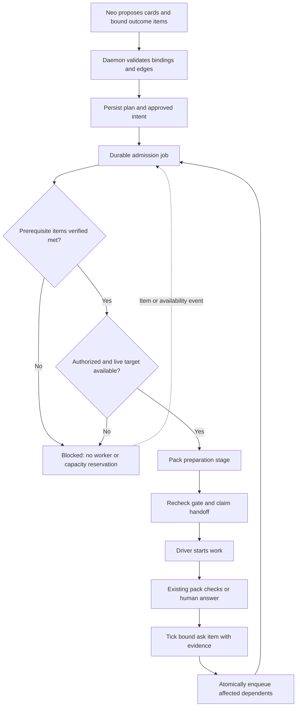
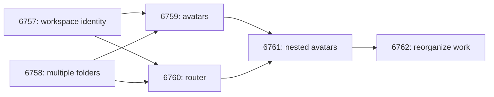
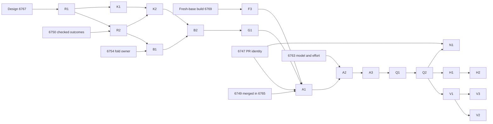

# Neo work dependencies

Status: proposal. Tracks [#6766](https://github.com/lsm/HyperNeo/issues/6766).
Design only; implementation requires separately scoped issues and PRs.

## Problem and boundary

Neo can plan an epic up front, but “wait for the earlier card” is not an execution gate.
Dependent workers must wait for their prerequisites' outcomes.

Neo proposes `neo.work` dependencies; deterministic daemon admission and dispatch use
persisted ask items, approval, and pack checks without needing a Neo LLM turn.

Do not reuse Space task tables, workflow scheduling, statuses, or completion logic. Neo cards
and external drivers are a different system. SQLite transactions and the durable job queue
are shared infrastructure, not Space task machinery.

The invariant is: **no first execution side effect until every prerequisite's bound outcome
items are verified met, the dependent card is authorized, and its target and pack preparation
are ready.** Creating a planning card does not create a worker or reserve execution capacity.

## Core: reuse existing outcomes

Use the existing ask checklist as the single completion system. Do not introduce
`neo_work_completion`, separate completion contracts, or a parallel verifier loop.

An outcome item gains `deliveredBy`, a stable Neo card ID identifying the card that delivers
it. This is distinct from `waitCard`, which identifies work an item is waiting for. A card
can deliver multiple outcome items. Its completion condition is every nonremoved outcome
item bound to it being `met`, with evidence valid for the current item definition and ask
revision. A prerequisite must have at least one bound outcome item; an empty set is never
complete. Questions, approval controls, and other interaction items are not outcome contracts.

There is no existing per-ask revision: snapshot `rev` / `sinceRev` is a global cursor.
Slice 1 adds integer `neo_asks.revision` for material text/check/watch/binding/scope edits.
Adding, removing, or replacing dependsOn edges bumps only the dependent card's owning ask;
never a separate prerequisite ask. No-op edits do not bump. Approval copies revision to `approved_revision`;
admission requires equality as well as valid existing approval. Each daemon tick or human
answer records a definition hash of the item's text, check, and watch alongside evidence and
`metBy`. Use a deterministic canonical encoding. Unchanged items retain valid evidence when
other edits bump the ask; a stale in-flight tick cannot verify a changed definition.

A worker report, report prefix, or Neo's assertion alone cannot tick a dependency outcome.
Registered checks tick items through the existing daemon event/timed-read paths. Evidence
accepted for prerequisites must come from an independent check or an explicit human answer
through `neo.ask.question`, bound to the item's definition and revision. `met` or `metBy`
alone is insufficient. Non-independent ticks can retain their existing checklist behavior.

For already-met items, admission validates the evidence against the current outcome definition.
An unrelated ask edit may preserve unchanged verified items; an outcome or binding edit
invalidates affected evidence and approval. Removing all bound items must block, not make
completion vacuously true. A changed `deliveredBy` binding clears its evidence even when the
definition hash is unchanged. Existing evidence without a hash needs reverification before admission.

## Core: bindings, graph, and registry

Persist bindings on ask items and edges in a Neo-owned dependency table. Extend
`neo_work_driver_targets` for admission/attempt bookkeeping, without another dispatch table.
Keep execution statuses and derive blockers separately from worker reports.

Validate a graph edit in one transaction:

- All cards exist, are visible to the caller, and belong to this daemon.
- Both ends of an edge have bound outcome items; bindings point to valid cards.
- No self-edge, duplicate edge, or cycle is accepted.
- Card, bindings, edges, and affected ask revisions are persisted before the result is exposed.

Cross-ask edges are allowed after ownership checks; approval stays per ask. The dependent's
approval never authorizes work in its prerequisite's ask. This is not a cross-daemon graph.
Superseding a card does not silently redirect edges. Dependencies and
bindings cannot be materially changed after dispatch; changed work requires a new card.

Neo supplies `dependsOn` through `neo.work.propose` / `neo.work.start`, and `deliveredBy` on
items through `neo.ask.open` / `neo.ask.edit`. Start may validate and persist pre-dispatch graph
edits, but cannot approve the resulting revision itself. Invalid plans return typed refusals
with blockers. Build referenced cards/items before adding edges; never expose partially validated plans.

Make check kinds pack-registered. `NeoPack.checks` already provides the contribution seam;
remove the hard-coded operation enum, shared closed union, and database CHECK constraint that
restrict kinds to today's packs. Core validates nonnull kinds against checks registered by
loaded packs, rejects collisions, and keeps the operation result schemas compatible with
pack-qualified strings. Each registration declares its evidence independence; missing metadata
defaults to non-independent. Admission rechecks the declaration and tick provenance; independent
checks cannot fall back to worker assertions. Changed/unloaded registrations cannot grandfather
evidence into eligibility. The migration preserves items; human eligibility needs a question answer.

An item explicitly configured without an automatic check is met only by a human through
`neo.ask.question`. A persisted nonnull check whose pack is unavailable remains blocked with
an unsupported-check reason; unloading a pack must not silently downgrade verification to
human-only or accept an old assertion. A newly submitted unknown kind is rejected.

## Core: one admission pipeline

One service-owned ADR 0004 pipeline covers Start, ask approval, retry, adopt, and recovery.
Thin operations and driver adapters do not implement their own dependency policies.

Named stages are:

1. All prerequisites' bound outcome items are met with valid evidence.
2. The card is active and authorized by the owning ask's approval and current revision.
3. Resolve a live target from the staffing pool (#6710) and check its execution capacity.
4. The pack's optional preparation stage succeeds.
5. A durable attempt is claimed and the driver handoff is recorded.

A blocked Start records authorized intent and returns structured blockers. Once eligible,
the daemon dispatches without another click or LLM instruction. Approval arms only cards in
the approved ask revision; later scope additions require renewed approval. Existing expiry
and cancellation rules still apply. A target override never bypasses prerequisite checks.

Archived or ended targets trigger retargeting within the authorized staffing pool, not failure
or an archived-target blocker. If no eligible live worker exists, retain a capacity blocker.
The durable job runs these stages in order; enqueueing it does not claim a worker attempt.
Preparation can take time. Recheck revisions, approval, cancellation, and prerequisite evidence
before the first worker side effect; never hold a database transaction over an external read.
Preparation resources need cleanup if admission becomes stale. Use durable claims and database
compare-and-set transitions, not only an in-memory pending set.

When an item becomes `met`, persist its evidence and enqueue affected dependents in the same
SQLite transaction using `enqueueUniquePending`. A dedicated Neo admission job reevaluates
the gate. Approval, target availability, and startup reconciliation can enqueue the same work.
Existing timed reads reconcile missed events and retry unavailable verification. No running
Neo conversation is required for this progression.

Duplicate events, repeated Start, and concurrent approvals cannot claim a second attempt.
A failed, cancelled, missing, or unverified prerequisite blocks dependents with a specific
reason without failing unrelated siblings. Cancelled dependents never revive on late events.
Abandoning a plan cancels its start intent rather than releasing its blocked work.

## Core: handoff and fold safety

Extend `neo_work_driver_targets`, which already records `started_at`, `sent_opening`, retries,
and interrupted starts. Reuse its existing retry-before-delivery path; retries reenter admission.

If an external start might have happened without an acknowledgement, persist `uncertain` and
reconcile recorded external identifiers instead of launching another worker. An adapter may
need to persist progress before returning its full summary. Do not claim exactly-once execution
with a non-idempotent driver. Before richer reconciliation ships, uncertain starts must remain
blocked for explicit recovery, never blind retry.

Folding asks preserves stable card IDs and their edges. In one transaction, move item bindings,
remap copied item IDs, move card ownership, validate the resulting graph, and update the kept
ask's revision. Preserve evidence only for unchanged outcomes. Approval is not inherited from
an abandoned source ask: newly folded work must be included in the kept ask's approved revision.
Enqueue admission only after this transaction. Normal abandonment cancels intent; an explicit
fold transfers it under the target ask's authorization policy. Never redirect an edge because
an item ID was copied or a card was superseded.

## Core: visibility

Blocked admission is derived in the ask view, with prerequisite card links and the specific
unmet outcome items. Show whether start is already authorized and will run automatically.
A blocked card creates no `needs_you` item, no question, and no stall continue. `ask-stall.ts`
ignores dependency-blocked cards; target-capacity accounting does not count planning cards.

Expose these derived fields through the existing snapshots to web and iOS. Distinguish worker
reports from met outcomes. A failed prerequisite or uncertain handoff has an attention action,
not a Start bypass. Human questions remain for actual human decisions or confirmation.

## Pack contributions

Under [ADR 0009](../adr/0009-neo-domain-packs.md), packs contribute stage functions to core
pipelines, not separate schedulers. Core knows registered checks and an optional preparation
stage; it knows nothing about PRs, branches, repositories, or GitHub. Drivers provide the
resource-owning execution seam; packs supply domain preparation requirements.

| Pack | Outcome checks | Preparation |
| --- | --- | --- |
| coding | Existing `coding.pr_merged`, issue/deployment checks, and watch readers | Fetch and prepare a fresh required target-branch checkout. |
| life-admin | Existing `life-admin.confirmed`, declared non-independent; prerequisites require a human question answer until #6768 supplies independent verification | None required. |
| future packs, such as legal | Register their own checks and evidence readers | Their own stage or none. |

Life-admin evidence is a separate audit/fix: [#6768](https://github.com/lsm/HyperNeo/issues/6768).
### Coding pack

Reuse `packs/coding/work-prs.ts`, `ask-prs.ts`, and the existing issue/watch/deployment readers.
A card's PR identity comes from the issue's closing PR relationship (`closingIssuesReferences`),
a PR explicitly named in the brief, or the bound item's watch reference. Never attribute an
outcome by branch or session claims: that would inherit the unrelated-PR attribution bug in
[#6747](https://github.com/lsm/HyperNeo/issues/6747). Ambiguous candidates remain pending.

A merged-outcome check validates the intended repository, issue/PR identity, required base,
and actual merge evidence. Green CI, review approval, a worker report, and issue closure as
not planned do not meet it. Tighten the existing checks rather than adding a second receipt
system. A watch becoming settled is not interchangeable with the required successful outcome.
Coding guidance teaches Neo to bind a `coding.pr_merged` item watching each card's issue before
a PR exists; `ask-prs.ts` already resolves an issue's `closedByPullRequestsReferences`.

The preparation stage fetches through the documented authenticated repository path, then
creates an isolated checkout from `origin/<target>`, not the user's local `HEAD`. Refuse start
if fetch fails. For dependent coding work, verify the base contains prerequisite merge commits.
Do not reset the user's checkout. This applies to independent coding cards too and is slice 0.
The pack supplies these requirements through the adapter seam rather than putting domain
logic into the generic admission service.

### Epic example

Every prerequisite card's own bound ask items require its PR merged into `dev`. Issue labels
below illustrate the plan; persisted dependency edges use Neo card IDs.

All planning cards can exist at once; eligible workers start on bases containing earlier merges.

## Implementation architecture: superpipe and pure functions

Use one direct superpipe pipeline per business path under ADR 0004, with named inputs and
typed gate results sharing a `result:<name>` output with disjoint `{ value } | { reason }`
arms. Do not build a mutable context bag, nested orchestration framework, or pack scheduler.
Pure functions decide; effect stages read or commit through the existing repository/adapter
seams. Packs supply stage functions composed into the core pipeline.

| Path | Pure functions | Effect stages |
| --- | --- | --- |
| Plan mutation | Normalize bindings, validate ownership/self-edges/cycles, compute material revision changes | Read snapshot; atomically commit items, edges, revision, and derived view |
| Item verification | Canonicalize/hash definition, validate evidence provenance, reject stale ticks | Read pack evidence or human answer; conditionally tick item and enqueue dependents |
| Admission | Evaluate prerequisites, approved revision, cancellation, target liveness/capacity | Read plan/staffing snapshot; prepare through pack; recheck; claim and hand off |
| Reconciliation | Classify known, absent, or ambiguous handoff; choose allowed transition | Read driver receipt; conditionally update existing target row and enqueue admission |

Pure functions receive immutable snapshots and explicit time values, never a database,
network client, worker session, or hidden clock. They return decisions, blockers, or change
sets without mutating inputs. Repository transactions enforce revisions and attempt tokens:
a pure decision against an old snapshot cannot authorize a stale write. Resource-owning
adapter shells stay imperative and consult the admission pipeline before worker effects.

Test pure functions with real inputs, then test pipeline effects through narrow seams. Assert
both decisions and absence of forbidden effects (no worker/worktree for blocked cards, no
second handoff for duplicate events). Do not mock the pipeline under test or mirror its stages
in test code.

## Implementation order and tests

Within each milestone, follow Pin → Extract → Build → Wire → Delete, measure fresh `dev`
diffs, and create one mapped issue and merge contract per slice within the production budget.

Test chains, fan-in/fan-out, cycles, transactional edits, empty/removed items, pack registration
and unloading, false worker reports, human answers, revision-bound approval, folds, and every
start path. Test duplicate events/concurrent starts, cancellation/supersession, restart and
uncertain handoffs, capacity changes, and archived-target retargeting. Coding tests cover unrelated PRs, wrong base, failed
fetch, and fresh bases containing prerequisite merge commits. Verify approved plans advance
while Neo is idle. Web/iOS checks cover blocker links and automatic-start visibility.

## Issue and PR execution plan

The labels below are planning IDs; F2 is now mapped to #6769. Create one implementation epic
under #6002 and map each eligible row to exactly one issue and one PR, reusing an existing issue only if
its purpose and merge contract match. Do not create or dispatch execution sessions for the
whole table up front. Planning issues may exist early; execution starts only after the listed
prerequisite PRs are verified merged into their repository's target branch. `D` is design PR #6767.

Measure each candidate row's call sites/diff against fresh `origin/dev` before its PR; record
exact production/test budgets in the issue and PR. Production stays within approximately 300
lines. Split any oversized row into separately mapped issues/PRs before coding. Construction,
wiring, and deletion remain separate; a few-line build+wire exception requires a measured
contract. New build modules must have a legitimate registered/discovery consumer for knip,
not unused exports or a fake production call added only to satisfy the check.

### Existing work: reuse and ordering

These dependencies bind to verified merged implementations, not merely closed issue states.
Read the resulting code before measuring a row; do not implement a competing sibling solution.

| Existing issue | Integration owner and required ordering |
| --- | --- |
| #6749 — live worker for archived target | Already merged in PR #6765 (`fc44fd0b`); A1 reuses its retargeting code. No second implementation. |
| #6747 — own-PR attribution | Its verified merge is required by A1's coding evidence integration and N1 guidance; audit against explicit issue/PR identity rather than trusting branch claims. |
| #6750 — checked outcomes and withdrawn PR questions | R2 waits for its merge; then K2 follows R2 and B2 follows K2, serializing neo.ask.open/edit changes. |
| #6754 — close/follow/fold | Owns the existing fold operation. B1/B2 wait for its merge; B1 owns the dependency binding remapping extension and B2 wires that extension, without rewriting fold ownership. |
| #6763 — model/effort per driver | A2 waits for its merge and preserves its driver request/refusal contract; do not independently rebuild work.start configuration. |

Recheck issue-to-PR mapping when each row becomes eligible. If an existing slice changes scope,
update this graph before dispatch rather than coding around its unmerged branch.

### Slice 0: fresh coding bases, independently eligible

| ID / issue purpose | Rung and concrete steps | Required merged PRs | Acceptance evidence |
| --- | --- | --- | --- |
| F2 — build fresh-base preparation (#6769) | Reuse preparation characterization; build pure target/ref and ancestry decisions plus fetch/checkout effect stages through the existing seam. | None; does not wait for D | Failed fetch creates no worker; checkout uses required remote target; user's checkout remains intact. |
| F3 — wire fresh coding starts | Replace the existing preparation call with the coding pack stage for every coding card, including independent cards. | F2 | Driver integration proves fresh remote base and no local-HEAD fallback. |

Reuse characterization first in F2/R1/K1; missing tests ride the slice. Only a measured missing
seam or substantial Pin rung adds a separate ADR 0004 predecessor. Keep Build/Wire separate.
F3 can land before D. No deployment is part of this track.

### Slice 1: outcomes, revisions, and registered checks

| ID / issue purpose | Rung and concrete steps | Required merged PRs | Acceptance evidence |
| --- | --- | --- | --- |
| R1 — build ask revision storage | Reuse outcome characterization; add revision/approved_revision and definition-hash storage with pure material-edit decisions. | D | Migration/backfill tests; material versus nonmaterial changes; legacy evidence cannot unlock work. |
| R2 — wire revision-safe mutations | Route edits, approval, daemon ticks, and human answers through revision/hash checks and atomic derived-view returns. | R1, #6750 | Stale ticks and approval rejected; unchanged-item evidence survives unrelated edits. |
| K1 — build check registry | Build pure loaded-pack validation, evidence-independence metadata and string schemas; migrate the hard-coded DB constraint. | R1 | Unknown/colliding kinds rejected; missing metadata is non-independent; existing kinds preserved. |
| K2 — wire registered checks | Swap operation validation/check dispatch to the registry, retaining existing checks' behavior. | K1, R2 | Loaded-pack checks work through the operations door; no life-admin behavior change. |
| B1 — build outcome bindings | Add deliveredBy persistence and pure validation; extend #6754's fold with binding remapping/invalidation. | R2, #6754 | Missing/foreign cards rejected; changed bindings clear evidence; fold preserves card identity. |
| B2 — wire binding operations | Add deliveredBy to neo.ask.open/edit and transactional fold behavior, returning updated views. | B1, K2 | Real operation tests prove atomic bindings/revisions and target-ask approval isolation. |

### Slice 2: graph, common admission, and deterministic dispatch

| ID / issue purpose | Rung and concrete steps | Required merged PRs | Acceptance evidence |
| --- | --- | --- | --- |
| G1 — build dependency graph | Add edges and pure DAG/blocker decisions; validate bound outcomes and bump only dependent-ask revision transactionally. | B2 | Late cross-ask dependent preserves prerequisite approval; edge edits invalidate dependent approval; same-ask revision, no-op, cycle and cancellation tests. |
| A1 — build admission pipeline | Compose pure gates/effects, including independent-check or recorded-human-answer eligibility; reuse #6749 retargeting; extend claims/uncertain state. | G1, F3, #6747; #6749 already merged | Self-attested met items cannot unlock dependents; human question answers can; duplicate claims and blocked worker effects prevented. |
| A2 — wire direct start paths | Route public Start and adoption through admission, preserving #6763's model/effort contract. | A1, #6763 | Direct/adopt tests cover blocked, retargeted, stale, uncertain, and configuration-refused attempts. |
| A3 — wire approval and recovery | Route approval fan-out, pre-delivery retries, and recovery through the same pipeline. | A2 | Every remaining start path respects dependencies and cancellation; no Promise.allSettled bypass. |
| Q1 — build dependency wake jobs | Register durable Neo admission jobs and atomic item-met/enqueue changes using enqueueUniquePending. | A3 | Duplicate events, queue restart, cancellation, and stale revisions cannot double-dispatch. |
| Q2 — expose plans and automatic dispatch | Wire dependsOn on neo.work.propose/start; activate item-met, approval, availability, and startup triggers. | Q1 | An approved chain progresses with Neo idle; invalid graph returns typed blockers; Start edits cannot self-approve. |

Do not expose dependency planning inputs before A3 covers every start path. Existing independent
cards must continue to work while these slices land. For staged wiring, gate new dependency
behavior until Q2; keep the daemon's eligibility decision authoritative rather than relying
on a prompt or hidden UI control. If a start path was missed, stop this track and fix its gate
before adding planning guidance.

### Slices 3 and 4: visibility and handoff reconciliation

| ID / issue purpose | Rung and concrete steps | Required merged PRs | Acceptance evidence |
| --- | --- | --- | --- |
| V1 — derive blockers in ask views | Add shared snapshot/view fields; exclude blocked plans from ask-stall and execution-capacity counts. | Q2 | Snapshot/derived-state tests distinguish reported, met, blocked, and uncertain states; no artificial question or stall continue. |
| V2 — show web dependency waits | Render prerequisite links, unmet items, authorized waiting, and attention actions in existing ask/card UI. | V1 | Focused accessible web interaction tests; no Start bypass; required web checks. |
| V3 — show iOS dependency waits (lsm/neo-ios) | Read new shared derived fields directly in the iOS ask surface; no old-daemon snapshot fallbacks. | V1 | Platform checks cover blocker links, automatic-start intent, and uncertainty actions. |
| H1 — build handoff reconciliation | Build pure reconciliation decisions and adapter receipt reads against existing target rows. | Q2 | Crash-before/after-start, absent receipts, and ambiguous external starts classified conservatively. |
| H2 — wire safe restart recovery | Replace uncertain-start recovery with the new pipeline; never blindly relaunch a possibly started worker. | H1 | Restart integration proves recorded handoff reuse and single dispatch under duplicate recovery triggers. |
| N1 — teach Neo dependency planning | Update coding guidance with bound issue-watching outcomes and dependsOn edges; V1 blocker visibility is useful but optional. | Q2, #6747 | Planning fixtures/evals produce valid staged plans before PRs exist; daemon enforces correctness without waiting for clients or H2. |

Removal-only cleanup PRs follow their replacement's verified merge only when an obsolete
bypass or hard-coded validator remains. Give each a separate measured issue; do not bundle
deletion into a build or wiring PR. Life-admin evidence audit #6768 is outside this epic.

### Dependency graph and dispatch policy for this implementation

An arrow requires an actual merged prerequisite PR, not approval, green CI, a worker report,
or an open sibling branch. HyperNeo PRs start from updated `dev`, never an unmerged sibling.
V3 uses lsm/neo-ios's documented target branch, checks, and merge rules; verify those before
creating its issue/PR. Both daemons are updated together; clients read the new contract directly.
Independently eligible branches can run concurrently only if staffing and
touch budgets allow; conflicting shared-file/schema work is serialized. Until neo.work gates
exist, enforce this table through explicit merge verification before opening the next worker.
After Q2 merges, create the remaining V1–N1 execution cards with real dependsOn edges and bound
outcome items as the first live dogfood plan. Include V2/V3 → V1 and H2 → H1; N1 needs Q2,
not client or reconciliation completion. Core progresses it without a Neo turn. The coding
pack verifies cross-repository outcomes, including V3's own repository/target. Record actual
dispatch/blocked evidence; retain conservative uncertain handling until H2. Manual verification
remains the merge audit, not a replacement scheduler for these remaining cards.

For each row: verify prerequisites → measure scope/call sites → create mapped issue with its
merge contract → implement/test the rung → run required repository checks → open PR targeting
dev with Closes #issue → fix review findings → verify current-head CI/review → merge under repo
rules → sync and audit issue closure. A prerequisite's merge failure keeps dependents blocked;
re-slicing updates this table before scheduling replacement work. No deployment is authorized.
