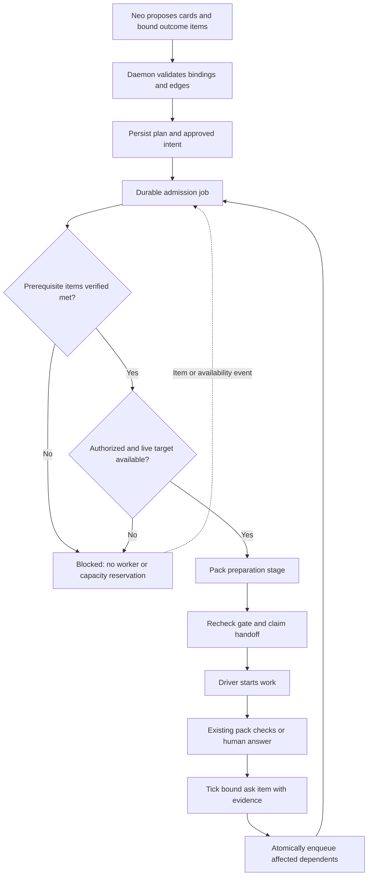
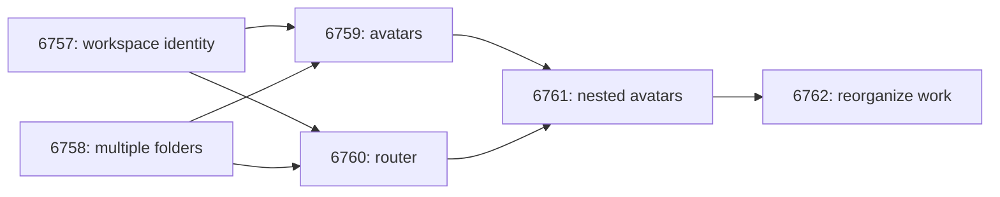

# Neo work dependencies

Status: proposal. Tracks [#6766](https://github.com/lsm/HyperNeo/issues/6766).
Design only; implementation requires separately scoped issues and PRs.

## Problem and boundary

Neo can plan an epic up front, but “wait for the earlier card” is not an execution gate.
Dependent workers must wait for their prerequisites' outcomes.

Neo proposes `neo.work` dependencies; deterministic daemon admission and dispatch use
persisted ask items, approval, and pack checks without needing a Neo LLM turn.

Do not reuse Space task tables, workflow scheduling, statuses, or completion logic. Neo cards
and external drivers are a different system. SQLite transactions and the durable job queue
are shared infrastructure, not Space task machinery.

The invariant is: **no first execution side effect until every prerequisite's bound outcome
items are verified met, the dependent card is authorized, and its target and pack preparation
are ready.** Creating a planning card does not create a worker or reserve execution capacity.

## Core: reuse existing outcomes

Use the existing ask checklist as the single completion system. Do not introduce
`neo_work_completion`, separate completion contracts, or a parallel verifier loop.

An outcome item gains `deliveredBy`, a stable Neo card ID identifying the card that delivers
it. This is distinct from `waitCard`, which identifies work an item is waiting for. A card
can deliver multiple outcome items. Its completion condition is every nonremoved outcome
item bound to it being `met`, with evidence valid for the current item definition and ask
revision. A prerequisite must have at least one bound outcome item; an empty set is never
complete. Questions, approval controls, and other interaction items are not outcome contracts.

There is no existing per-ask revision: snapshot `rev` / `sinceRev` is a global cursor.
Slice 1 adds integer `neo_asks.revision`, bumped only by material edits: outcome text, check,
watch, bindings, edges, or card scope. Approval sets `approved_revision` to that revision;
admission requires equality as well as valid existing approval. Each daemon tick or human
answer records a definition hash of the item's text, check, and watch alongside evidence and
`metBy`. Use a deterministic canonical encoding. Unchanged items retain valid evidence when
other edits bump the ask; a stale in-flight tick cannot verify a changed definition.

A worker report, report prefix, or Neo's assertion alone cannot tick a dependency outcome.
Registered checks tick items through the existing daemon event/timed-read paths. Evidence
accepted by those checks must verify the item's exact outcome. Explicit human answers use `neo.ask.question`
and are bound to the question's item definition and revision. There is no new confirm flow.

For already-met items, admission validates the evidence against the current outcome definition.
An unrelated ask edit may preserve unchanged verified items; an outcome or binding edit
invalidates affected evidence and approval. Removing all bound items must block, not make
completion vacuously true. A changed `deliveredBy` binding clears its evidence even when the
definition hash is unchanged. Existing evidence without a hash needs reverification before admission.

## Core: bindings, graph, and registry

Persist bindings on ask items and edges in a Neo-owned dependency table. Extend
`neo_work_driver_targets` for admission/attempt bookkeeping, without another dispatch table.
Keep execution statuses and derive blockers separately from worker reports.

Validate a graph edit in one transaction:

- All cards exist, are visible to the caller, and belong to this daemon.
- Both ends of an edge have bound outcome items; bindings point to valid cards.
- No self-edge, duplicate edge, or cycle is accepted.
- Card, bindings, edges, and affected ask revisions are persisted before the result is exposed.

Cross-ask edges are allowed after ownership checks; approval stays per ask. The dependent's
approval never authorizes work in its prerequisite's ask. This is not a cross-daemon graph.
Superseding a card does not silently redirect edges. Dependencies and
bindings cannot be materially changed after dispatch; changed work requires a new card.

Neo supplies `dependsOn` through `neo.work.propose` / `neo.work.start`, and `deliveredBy` on
items through `neo.ask.open` / `neo.ask.edit`. Start may validate and persist pre-dispatch graph
edits, but cannot approve the resulting revision itself. Invalid plans return typed refusals
with blockers. Build referenced cards/items before adding edges; never expose partially validated plans.

Make check kinds pack-registered. `NeoPack.checks` already provides the contribution seam;
remove the hard-coded operation enum, shared closed union, and database CHECK constraint that
restrict kinds to today's packs. Core validates nonnull kinds against checks registered by
loaded packs, rejects collisions, and keeps the operation result schemas compatible with
pack-qualified strings. The migration preserves existing items.

An item explicitly configured without an automatic check is met only by a human through
`neo.ask.question`. A persisted nonnull check whose pack is unavailable remains blocked with
an unsupported-check reason; unloading a pack must not silently downgrade verification to
human-only or accept an old assertion. A newly submitted unknown kind is rejected.

## Core: one admission pipeline

One service-owned ADR 0004 pipeline covers Start, ask approval, retry, adopt, and recovery.
Thin operations and driver adapters do not implement their own dependency policies.

Named stages are:

1. All prerequisites' bound outcome items are met with valid evidence.
2. The card is active and authorized by the owning ask's approval and current revision.
3. Resolve a live target from the staffing pool (#6710) and check its execution capacity.
4. The pack's optional preparation stage succeeds.
5. A durable attempt is claimed and the driver handoff is recorded.

A blocked Start records authorized intent and returns structured blockers. Once eligible,
the daemon dispatches without another click or LLM instruction. Approval arms only cards in
the approved ask revision; later scope additions require renewed approval. Existing expiry
and cancellation rules still apply. A target override never bypasses prerequisite checks.

Archived or ended targets trigger retargeting within the authorized staffing pool, not failure
or an archived-target blocker. If no eligible live worker exists, retain a capacity blocker.
The durable job runs these stages in order; enqueueing it does not claim a worker attempt.
Preparation can take time. Recheck revisions, approval, cancellation, and prerequisite evidence
before the first worker side effect; never hold a database transaction over an external read.
Preparation resources need cleanup if admission becomes stale. Use durable claims and database
compare-and-set transitions, not only an in-memory pending set.

When an item becomes `met`, persist its evidence and enqueue affected dependents in the same
SQLite transaction using `enqueueUniquePending`. A dedicated Neo admission job reevaluates
the gate. Approval, target availability, and startup reconciliation can enqueue the same work.
Existing timed reads reconcile missed events and retry unavailable verification. No running
Neo conversation is required for this progression.

Duplicate events, repeated Start, and concurrent approvals cannot claim a second attempt.
A failed, cancelled, missing, or unverified prerequisite blocks dependents with a specific
reason without failing unrelated siblings. Cancelled dependents never revive on late events.
Abandoning a plan cancels its start intent rather than releasing its blocked work.

## Core: handoff and fold safety

Extend `neo_work_driver_targets`, which already records `started_at`, `sent_opening`, retries,
and interrupted starts. Reuse its existing retry-before-delivery path; retries reenter admission.

If an external start might have happened without an acknowledgement, persist `uncertain` and
reconcile recorded external identifiers instead of launching another worker. An adapter may
need to persist progress before returning its full summary. Do not claim exactly-once execution
with a non-idempotent driver. Before richer reconciliation ships, uncertain starts must remain
blocked for explicit recovery, never blind retry.

Folding asks preserves stable card IDs and their edges. In one transaction, move item bindings,
remap copied item IDs, move card ownership, validate the resulting graph, and update the kept
ask's revision. Preserve evidence only for unchanged outcomes. Approval is not inherited from
an abandoned source ask: newly folded work must be included in the kept ask's approved revision.
Enqueue admission only after this transaction. Normal abandonment cancels intent; an explicit
fold transfers it under the target ask's authorization policy. Never redirect an edge because
an item ID was copied or a card was superseded.

## Core: visibility

Blocked admission is derived in the ask view, with prerequisite card links and the specific
unmet outcome items. Show whether start is already authorized and will run automatically.
A blocked card creates no `needs_you` item, no question, and no stall continue. `ask-stall.ts`
ignores dependency-blocked cards; target-capacity accounting does not count planning cards.

Expose these derived fields through the existing snapshots to web and iOS. Distinguish worker
reports from met outcomes. A failed prerequisite or uncertain handoff has an attention action,
not a Start bypass. Human questions remain for actual human decisions or confirmation.

## Pack contributions

Under [ADR 0009](../adr/0009-neo-domain-packs.md), packs contribute stage functions to core
pipelines, not separate schedulers. Core knows registered checks and an optional preparation
stage; it knows nothing about PRs, branches, repositories, or GitHub. Drivers provide the
resource-owning execution seam; packs supply domain preparation requirements.

| Pack | Outcome checks | Preparation |
| --- | --- | --- |
| coding | Existing `coding.pr_merged`, issue/deployment checks, and watch readers | Fetch and prepare a fresh required target-branch checkout. |
| life-admin | Existing `life-admin.confirmed`; no behavior change in these slices | None required. |
| future packs, such as legal | Register their own checks and evidence readers | Their own stage or none. |

Life-admin confirmation evidence is a separate audit/fix in [#6768](https://github.com/lsm/HyperNeo/issues/6768).

### Coding pack

Reuse `packs/coding/work-prs.ts`, `ask-prs.ts`, and the existing issue/watch/deployment readers.
A card's PR identity comes from the issue's closing PR relationship (`closingIssuesReferences`),
a PR explicitly named in the brief, or the bound item's watch reference. Never attribute an
outcome by branch or session claims: that would inherit the unrelated-PR attribution bug in
[#6747](https://github.com/lsm/HyperNeo/issues/6747). Ambiguous candidates remain pending.

A merged-outcome check validates the intended repository, issue/PR identity, required base,
and actual merge evidence. Green CI, review approval, a worker report, and issue closure as
not planned do not meet it. Tighten the existing checks rather than adding a second receipt
system. A watch becoming settled is not interchangeable with the required successful outcome.
Coding guidance teaches Neo to bind a `coding.pr_merged` item watching each card's issue before
a PR exists; `ask-prs.ts` already resolves an issue's `closedByPullRequestsReferences`.

The preparation stage fetches through the documented authenticated repository path, then
creates an isolated checkout from `origin/<target>`, not the user's local `HEAD`. Refuse start
if fetch fails. For dependent coding work, verify the base contains prerequisite merge commits.
Do not reset the user's checkout. This applies to independent coding cards too and is slice 0.
The pack supplies these requirements through the adapter seam rather than putting domain
logic into the generic admission service.

### Epic example

Every prerequisite card's own bound ask items require its PR merged into `dev`. Issue labels
below illustrate the plan; persisted dependency edges use Neo card IDs.

All planning cards can exist at once; eligible workers start on bases containing earlier merges.

## Implementation order and tests

Within each milestone, follow Pin → Extract → Build → Wire → Delete, measure fresh `dev`
diffs, and create one mapped issue and merge contract per slice within the production budget.

0. **Coding pack fresh base:** fetch and prepare the required remote target for every coding
   card; refuse failed fetches. Independent of this design's merge and all subsequent slices.
1. **Binding and registry:** bindings, pack-registered kinds, per-ask `revision` and
   `approved_revision`, definition hashes, and evidence validity. No external revision slice exists.
2. **The gate:** edges, the admission pipeline on every start path, durable claims, and dispatch
   on item met. Retain conservative uncertain-start blocking from the first wired version.
3. **Visibility:** dependency blockers in the ask view, web, and iOS; exclude blocked work from
   stall detection and capacity accounting.
4. **Reconciliation:** extend existing handoff rows with automatic uncertain-start recovery.

Test chains, fan-in/fan-out, cycles, transactional edits, empty/removed items, pack registration
and unloading, false worker reports, human answers, revision-bound approval, folds, and every
start path. Test duplicate events/concurrent starts, cancellation/supersession, restart and
uncertain handoffs, capacity changes, and archived-target retargeting. Coding tests cover unrelated PRs, wrong base, failed
fetch, and fresh bases containing prerequisite merge commits. Verify approved plans advance
while Neo is idle. Web/iOS checks cover blocker links and automatic-start visibility.

Run required checks per slice. This document changes no runtime behavior or execution cards.
