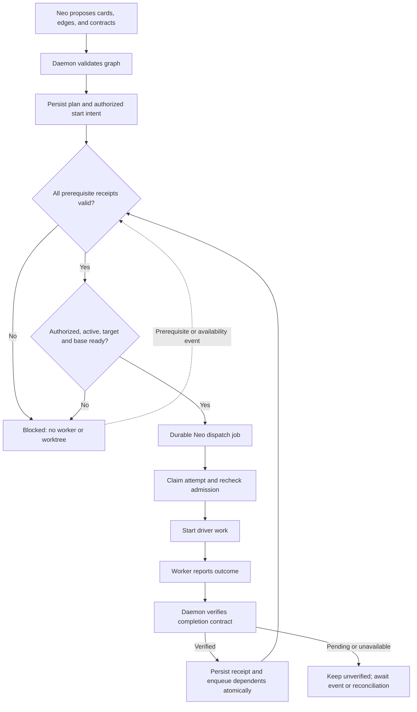
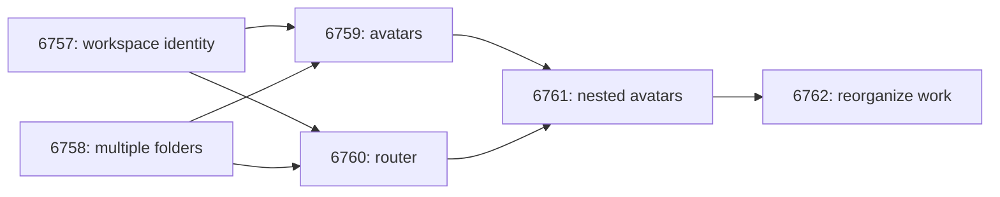

# Neo work dependencies

Status: proposal. Tracks [#6766](https://github.com/lsm/HyperNeo/issues/6766).
This PR documents the design; implementation requires separately scoped issues and PRs.

## Problem and boundary

Neo can propose an entire epic up front, but a prompt saying “wait for the earlier PR” is not
an execution gate. Dependent work can start on an incomplete codebase, occupy a worker, or
report completion without satisfying the prerequisite the next card actually needs.

Add a dependency graph owned by `neo.work`. The daemon validates prerequisites, verifies
completion, and dispatches eligible cards without requiring a Neo LLM turn. Neo proposes the
plan and explains changes; it does not decide whether stored dependencies are satisfied.

Do not reuse Space task tables, workflow scheduling, task statuses, or task completion logic.
Neo cards and their external drivers are a different system. Shared SQLite transactions,
the durable job queue, and existing Neo GitHub readers remain reusable infrastructure.

The invariant is: **no first execution side effect until every prerequisite has a valid
completion receipt, the dependent card is authorized, and its execution base is ready.**
Creating a planning card is allowed before its prerequisites complete. Creating its worker
session or worktree is not.

## Existing seams

The investigation used `dev` at `fc44fd0b43deb2d7624df275e5b9c5180edcb89d`.

| Seam | Current behavior | Required change |
| --- | --- | --- |
| `packages/shared/src/types/neo-context.ts` | Work cards have execution status but no dependency graph or verified completion receipt. | Add orthogonal admission and completion data. |
| `packages/daemon/src/lib/neo/ask-operations.ts` | Ask approval can start proposed cards together through `Promise.allSettled`. | Arm authorized cards, then use the common dispatch gate. |
| `packages/daemon/src/lib/neo/service.ts` | Start, recovery, driver refresh, and completion checks meet here. | Enforce admission before every execution path. |
| `packages/daemon/src/lib/neo/card-wake.ts` and `work-close.ts` | Report prefixes and ask checklist state can classify a card as done. | Do not use those signals as dependency completion proof. |
| `packages/daemon/src/lib/neo/packs/coding/work-prs.ts` and `ask-prs.ts` | Existing GitHub readers resolve PRs and linked issues. | Extend structured evidence with the exact contract fields. |
| `packages/daemon/src/lib/neo/driver-refresh.ts` | Durable refresh work already reconciles driver state. | Reuse the infrastructure for missed events and verification retries. |
| `packages/daemon/src/lib/drivers/codex-desktop-adapter.ts` | `prepareCodexWorkFolder` creates a detached worktree from local `HEAD`. | Prepare the verified target branch base before coding dispatch. |

`reported` means a worker has reported, not that a prerequisite is verified complete.
Existing `neo_work_check` notification signatures are also not completion receipts.
Life-admin evidence derived from a worker's “Confirmation” report must not become independent
verification merely because a daemon parser accepted the text.

## Graph and completion contracts

Edges reference stable Neo work card IDs in the owning daemon. External driver tasks can
participate through their Neo cards; this proposal does not introduce a distributed graph
across daemons. Resolve visibility and ownership before accepting an edge.

The following operation shape is illustrative, not a finalized wire schema:

```json
{
  "dependsOn": ["work-6757", "work-6758"],
  "completion": {
    "all": [
      {
        "kind": "coding.pr_merged",
        "repository": "lsm/HyperNeo",
        "issue": 6759,
        "base": "dev"
      }
    ]
  }
}
```

`dependsOn` gates this card's admission. `completion` describes this card's own outcome,
which the daemon must verify before downstream cards can use it as a prerequisite.
All prerequisites must be verified; the first version has no OR edges or optional edges.
Independent legacy cards may omit a completion contract. A card cannot be referenced as a
prerequisite until it has a supported, nonempty completion contract.

Persist proposed Neo-owned records:

- `neo_work_dependencies`: directed edges, indexed by dependent and prerequisite.
- `neo_work_completion`: contract revision and structured verification receipts.
- `neo_work_dispatch`: approved start intent, admission state, durable attempt identity,
  and external handoff receipt.

Validate missing cards, ownership, self-dependencies, and cycles transactionally. Persist
the card, graph, and contract before exposing a startable result. Do not leave a window
where a card can start before its edges exist.

A coding receipt must identify the exact repository, linked issue or explicitly selected
PR, required base branch, merged PR, merge commit, verifier, and verification time. Extend
the existing readers rather than introducing a second GitHub transport. Green CI, an
approval, an unrelated merged PR, and an issue closed as not planned do not satisfy
`coding.pr_merged`. If multiple candidate PRs make the contract ambiguous, retain the
blocker until the intended outcome is explicitly selected.

For other supported outcomes, use a deterministic external verifier where available.
Otherwise require an explicit human confirmation bound to the outcome and contract revision.
A worker report or Neo assertion remains unverified. Arbitrary prose “done when” is not a
supported automatic dependency contract in the first version.

Receipts bind to a monotonic contract revision. A scope or contract edit invalidates earlier
receipts for future dispatch. Removing a checklist item or replacing the contract with an
empty list cannot establish completion. An unavailable external read leaves the card
unverified and records a retryable verification reason.

## Deterministic admission and dispatch

Keep existing execution statuses (`proposed`, `queued`, `reported`, `failed`, `cancelled`).
Add an orthogonal admission state: `blocked`, `ready`, `dispatching`, `dispatched`, or
`uncertain`. Completion is independently unverified or verified for a contract revision.
An unarmed card may be ready, but it is never automatically dispatched.



One service-owned admission pipeline covers public Start, ask approval, retries, adopted
work, and recovery. Follow ADR 0004 with named stages and typed rejections; thin operation
and driver adapters must not implement their own dependency policies.

Start on a blocked card records authorized intent and returns structured blockers. Once
eligible, the daemon dispatches it without another Start click or LLM instruction. Approval
arms only cards within the approved plan revision; later additions or material scope changes
require renewed authorization. A busy-target override never bypasses dependency verification.

Before dispatching coding work, prepare an isolated checkout from the current required
remote target branch and verify that it contains the prerequisite merge commits. Reuse
the repository's documented authenticated fetch path. A failed fetch, unavailable target,
or missing ancestry blocks dispatch; do not fall back to local `HEAD` or reset the user's
checkout. Delayed dispatch by itself does not guarantee a correct codebase.

Persisting a new verified receipt and enqueueing affected dependents happen in the same
SQLite transaction. Register a dedicated Neo dispatch job using the existing durable queue.
The job rechecks authorization, card revision, prerequisite receipts, cancellation, target
availability, and base readiness before claiming an attempt. Approval, target availability,
startup reconciliation, and external evidence events can enqueue the same idempotent work.
Existing refresh infrastructure handles missed events and bounded verification retries.
No Neo conversation needs to be running for these transitions.

Database compare-and-set transitions and durable attempt claims prevent concurrent starts;
an in-memory pending set is insufficient after restart. Enforce target admission limits at
dispatch, not just at proposal time. Blocked planning cards do not consume worker capacity
and are excluded from execution-stall detection.

External drivers do not necessarily offer idempotent start. Persist handoff progress and
external identifiers at the adapter boundary. If a crash occurs after a possible external
start but before acknowledgement, mark the attempt `uncertain` and reconcile that recorded
handoff. Never blindly launch a replacement worker. This design does not claim exactly-once
execution across a non-idempotent external API.

## Failures and edits

- Failed, cancelled, missing, or unverified prerequisites block dependents with specific
  reasons. They do not automatically fail unrelated siblings.
- Superseding a prerequisite does not silently redirect its edges to the replacement.
  An explicit validated graph edit is required.
- Dependencies can change only before dispatch. Changed scope after dispatch uses a new
  card; already-started work is not retroactively treated as safely gated.
- Cancelled dependents never revive when a late merge event arrives. Deleting an owning
  plan must cancel its start intent rather than release blocked work.
- Duplicate events, repeated Start, and concurrent approvals cannot create a second
  dispatch claim. Unavailable verifiers remain visible blockers with retry state.

## User experience and epic example

Show blocked cards in a waiting group, with prerequisite card links, exact unsatisfied
contracts, and verification state. Distinguish “worker reported” from “verified complete”.
Show approved automatic start intent so users do not have to click Start repeatedly.
Failed prerequisites and uncertain handoffs need attention actions; neither gets a bypass
that silently launches dependent work. Planning guidance can suggest edges, but correctness
is enforced by the daemon.

The previously discussed epic can be planned up front while executing in stages. These
issue labels illustrate the graph; stored edges use the corresponding Neo card IDs.



Each prerequisite's coding contract requires its PR merged into `dev`. The next stage then
starts from a verified `dev` base containing those merges. The design therefore permits
creating every planning card at once without creating every execution session at once.

## Implementation slices and validation

Use the repository's Pin → Extract → Build → Wire → Delete ladder. Measure production
diffs and set explicit merge contracts before opening each implementation slice; the
following ownership sequence is not permission to bundle these into one large PR:

1. Pin surviving start, approval, report, and recovery behavior with characterization tests.
2. Extract existing Neo evidence and admission seams where needed, preserving behavior.
3. Build Neo graph persistence, validation, contract revisions, and completion verifiers.
4. Build durable admission/dispatch pipelines and driver handoff reconciliation.
5. Wire every start path and fresh coding base preparation through those pipelines.
6. Wire shared snapshots and web waiting/verification views, then update Neo planning guidance.
7. Delete obsolete bypasses in separate removal slices if characterization identifies any.

Tests must cover chains, fan-in and fan-out; all prerequisites completing; cycle rejection;
worker reports and unrelated PRs not unlocking work; wrong repository/base and empty contracts;
human confirmation revision binding; every start path; concurrent Start and duplicate events;
cancellation and supersession; restart and uncertain handoffs; target occupancy; and fresh
bases containing prerequisite merge commits. Verify that a stored, approved plan progresses
while Neo's LLM session is idle. Web tests cover blocker links, verification distinction,
authorized waiting state, and attention controls.

Run the required repository checks with each slice. This document changes no runtime behavior,
creates no execution cards, and authorizes no deployment.

## Review focus

Review the receipt schema and supported contract kinds, the authorization boundary for plan
edits, the common gate's coverage of adoption/recovery, and the adapter handoff persistence
needed to avoid duplicate execution after a crash. Keep cross-daemon dependencies out of the
first version. Decide final operation and snapshot schemas during the measured implementation
slices rather than treating the illustrative JSON or proposed table names as shipped APIs.
